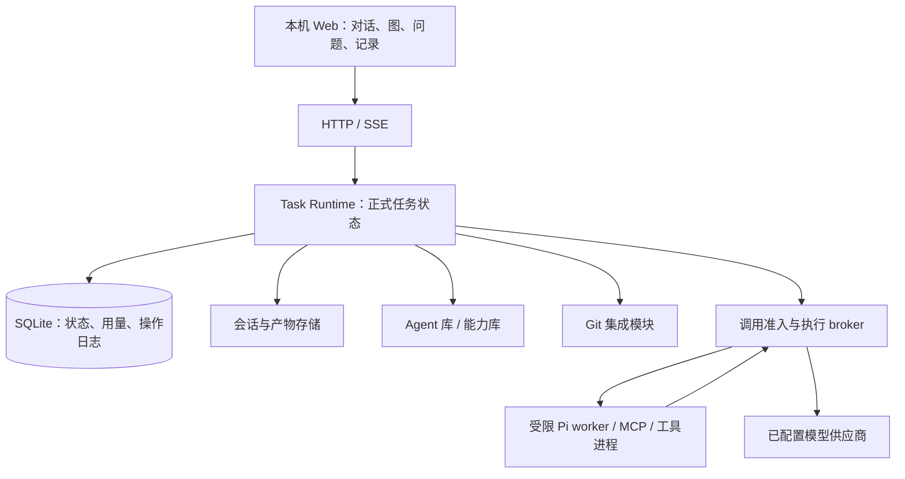

# Graph 实现架构

日期：2026-09-12。基于使用者已确认的 [首版设计](graph-mvp.md)。本文为完整工程方案；M0 已验证固定版本 Pi 的受控接入及当前 macOS 执行限制，见 [M0 报告](planning/m0-results.md)。M1 已实现任务入口、固定 DAG、操作结算和恢复核对，见 [M1 报告](planning/m1-results.md)。M2 已实现版本化图、容器、回环、主管修订、连续调度与三类验证器，见 [M2 报告](planning/m2-results.md)。M3 已实现生产 Pi adapter、模型目录、Agent 库与主管规划，见 [M3 报告](planning/m3-results.md)。M4 已实现实例工作副本、任务集成分支与自动合入，见 [M4 报告](planning/m4-results.md)。Web 仍按 [实施计划](implementation-plan.md) 实现。

## 架构选择

采用 **TypeScript 自有执行内核 + Pi Agent + SQLite + 本机 Web**。首版不引入 LangGraph 或 Rust；全部图模式和验证器仍在首版范围内。

### 三种接口方案的比较

1. [命令式持久内核](planning/kernel-minimal.md)：submit / inspect / watch 三个入口隐藏图执行、预算、恢复与集成。规则集中，适合作为内部 implementation；若将所有命令直接暴露给 Web，调用者仍需理解较多执行概念。
2. [可组合图接口](planning/kernel-flexible.md)：声明图、注册动作、提交图修订，表达能力最强，适合主管与模板实现；作为用户入口会暴露过多图协议。LangGraph 的具体映射需要额外维护业务图身份和调用控制，并不能消除 Graph 的正式状态库。[LangGraph Graph API](https://docs.langchain.com/oss/javascript/langgraph/graph-api)、[恢复规则](https://docs.langchain.com/oss/javascript/langgraph/interrupts)
3. [任务级 Runtime](planning/kernel-task-runtime.md)：Web 使用“讨论、确认、暂停、答复、查看”的任务 interface，内部负责完整生命周期。最符合用户主要操作，但需要控制内部职责，防止任务 module 膨胀。

选用第三种作为外部 interface，将第一种的持久化命令处理和第二种的图描述放在同一个任务 module 内部。不是同时建立三套公开 Runtime。规则的 locality 在任务内核；模板只生成图数据，Pi 只执行 Agent，Web 只呈现状态。

## 技术基线

| 部分 | 规划选择 | 理由与验证边界 |
| --- | --- | --- |
| 运行时 | Node.js 24 LTS、TypeScript ESM、pnpm | Pi 与 Web 共用语言；M0 固定准确补丁和包版本，不修改其他项目环境。 |
| Agent | Pi SDK，经受控 adapter 接入 | 独立会话、模型与工具；M0 验证逐调用控制，不把整个 prompt 当成一个不可观察动作。 |
| 图执行 | 自有持久状态机和版本化图描述 | 稳定实例身份、动态节点、全局名额和程序权威统一管理。 |
| 持久化 | SQLite WAL + FULL；node:sqlite 封装在内部 | 本机单写者短事务。Node 驱动仍为 release candidate，M0 固定版本并做磁盘数据库验证。 |
| 本地 HTTP | Fastify，HTTP 命令/查询 + SSE 更新 | 长任务不占 HTTP 请求；浏览器断线从事件游标续接。 |
| 界面 | React + Vite + React Flow，elkjs 自动布局 | 图为执行状态投影，支持子图展开、回边与节点详情，无手工编排。 |
| 代码隔离 | Git worktree + 受控 Git 操作 | 每实例副本、任务集成分支、目标分支核验。 |
| MCP | 官方 TypeScript client，经工具执行 adapter 管理 | 本地 stdio 和远程连接；连接不等于权限授权。 |
| 测试 | Vitest、临时磁盘 SQLite/真实 Git、Playwright | 核心从任务 interface 测试，真实 Pi 契约与 OS 执行约束另测。 |

运行时、存储、Web 与执行限制的来源和本机版本见 [基础核查](planning/runtime-foundations.md)。版本锁定是 M0 的产物，本文不把未安装的依赖写成已验证组合。

## 进程与模块



后台独立启动，关闭浏览器不停止它。第一次实现采用单后台所有者；额外启动的后台不能领取同一任务。macOS 自动重启由本机进程宿主接入，数据库恢复协议保持独立于启动方式。

| Module | Interface 的主要责任 | Implementation 隐藏的复杂性 |
| --- | --- | --- |
| Task Runtime | 任务讨论/确认、控制、问题答复、查询与订阅 | 图修订、就绪判断、名额、预算、验收、恢复、队列及正式状态写入。 |
| Agent execution | 恢复指定实例、推进、回传调用事件与结果 | Pi 会话、模型切换、上下文说明包、压缩摘要、逐请求 usage；生产 Pi 与 scripted 测试 adapter。 |
| Operation execution | 执行已准入操作、核查不明结果 | 文件/进程/MCP/模型实际派发、OS 限制、凭据、前置事实和结果证据。 |
| Catalog | 安装/发布版本、解析可复用定义 | Skills/MCP/扩展来源、版本、完整配置快照、实例版本固定。 |
| Git integration | 准备实例副本、汇集修改、验证后合入 | 分支与工作树、冲突、目标变化、精确提交证据和崩溃后核查。 |

纯图规则、预算算术、模板和数据库事务为 Task Runtime 的内部 implementation，不为每个计算拆一层 adapter。SQLite/Git 测试使用真实临时文件与仓库。Pi、供应商和远程 MCP 才使用可控替身与生产 adapter 两套实现。

保持单一仓库与单一领域上下文，先按 `src/core/`、`src/runtime/`、`src/catalog/`、`src/git/`、`src/server/`、`src/web/` 组织内部代码；不因有前后端就引入多包工作区或多份 CONTEXT。

## 外部任务 interface

完整设计用类型。M1 可调用入口为 `openTaskRuntime(...).user`，具体行为和当前支持范围见 M1 报告：

```ts
interface TaskRuntime {
  begin(input: { projectId: string; request: string; requestId: string }): Promise<TaskHandle>;
  task(taskId: string): TaskHandle;
}

interface TaskHandle {
  say(text: string, requestId: string): Promise<Receipt>;
  accept(input: { proposalVersion: number; targetBranch: string; requestId: string }): Promise<Receipt>;
  pause(requestId: string): Promise<Receipt>;
  resume(requestId: string): Promise<Receipt>;
  answer(questionId: string, answer: Answer, requestId: string): Promise<Receipt>;
  view(): Promise<TaskView>;
  watch(after?: string): AsyncIterable<TaskUpdate>;
}
```

- Receipt 只确认持久受理；任务已完成或已暂停从 view/watch 查询。关闭 watch 不关闭任务。
- requestId 与内容绑定；相同请求重送返回原回执，不重复派发；同键异内容拒绝。
- accept 必须引用已展示的当前需求版本；新增功能 begin 新任务，当前任务验收范围不扩张。
- 用户身份由本机会话与 transport 绑定，不能靠 payload 写 `actor: user` 获得授权。主管使用内部受限提案通道，不能调用追加额度、扩大权限和发布的用户答复路径。
- TaskView 为投影，包含任务阶段、稳定节点、问题、额度摘要、交付证据与游标；大日志与会话分页读取。
- 版本冲突、非法配置和错误答复同步返回可处理错误；额度耗尽、模型不可用、无进展、结果不明是持久待处理问题。

## 正式数据与身份

| 记录 | 必要关系 |
| --- | --- |
| Project / FeatureTask | 项目位置和任务队列；任务记录目标分支、需求与验收版本。 |
| GraphRevision / Node / Container | 图版本不可覆盖，节点稳定；容器不是实例。 |
| AgentDefinitionVersion / CapabilityVersion | 已发布版本不可变；模型等级推荐与具体模型分开。 |
| AgentInstance / Activation | 实例与 Agent 节点双向唯一；Activation 区分重复激活，执行轮次区分实现/检查/审查循环。 |
| Operation / Invocation | 每次真实模型或工具动作一个 operation，模型实际请求有唯一 invocation；重试用新 ID 但同一额度归属。 |
| Usage / Reservation | 按实例预留与结算；供应商请求 ID 和原始归一化来源去重。 |
| Artifact / Evidence / Acceptance | 绑定具体提交或内容摘要、输入版本、执行轮次和验收版本；不能以旧通过结论验证新代码。 |
| Intervention / Grant / Command / Event | 问题范围、真实答复主体、权限上限、幂等回执与可续接更新记录。 |

SQLite 保存正式状态与追加审计记录，两者同事务提交；Pi 会话文件负责对话上下文，不反向覆盖任务状态。大型正文和产物用内容引用保存，数据库记录摘要与适用范围。首版不要求完整 event sourcing，也不自动删除历史记录。

## 调度与图修订

- 一次执行一个功能任务；所有 Agent 调用进入同一 10 名额池，主管计入。同实例不能并行激活两次，等待依赖/结果释放名额。
- 每次汇合绑定本次分支集合、循环激活和输入版本。必需失败阻塞，可选缺席允许；旧轮次结果不能错误满足新轮次。
- 动态图提案携带原版本与原因；先验证结构、身份、验收范围和权限，受影响调用停稳后再生效。旧节点保留停用记录，不能删除调用历史。
- 预算耗尽的未完成工作保持阻塞，改名、换节点或派新实例不能清除它。重新分派必须关联来源工作；程序无法确定是否为规避额度时交用户核对。
- 程序节点不占 Agent 名额，但仍经过暂停、权限与操作日志；工具进程另作资源调度，不能无限启动进程。
- Graph 模板展开为同一图描述：顺序、路由、扇出汇合、主管等待/唤醒、原节点回环，以及三种验证器均共用上述规则。

## 逐调用准入和恢复

模型、工具、压缩、摘要、provider 重试和扩展触发的请求均须过实际派发入口；提前执行一次 hook 不能代替派发前检查。

1. 短事务校验任务/节点阻塞、权限、名额及额度，登记操作意图、输入摘要、预期对象和调用归属。
2. 事务提交后，受控 broker 将实际派发与暂停门按顺序处理。准入许可不允许 worker 长期持有后自行发送。
3. 保存调用结果和原始 usage，按唯一 invocation 结算、释放预留、记录证据，随后计算后继。
4. 崩溃重启后先核查仍在运行的 worker、操作意图及外部结果。代次只阻止旧结果改变正式状态，不能撤销已经发出的系统调用。
5. 结果明确则补记；确认未发生且可重做才重试；不明则保持阻塞等待核对。不能承诺任意外部操作恰好一次。

用量未知与恢复重试同时发生时，优先执行“待核对并暂停该 Agent”的规则；核对后再重新发起并累计，不能将缺失用量记零。重放会话和主管汇总子 Agent 统计不能重复扣除同一调用。

暂停先关门，已发调用可结束，所有在途调用停稳后才报告 paused；长工具持续运行时保留 pausing 和对应记录，时长不限不意味着能虚报暂停成功。resume 不能解除未解决的预算或权限问题。

## 能力安装与权限落实

能力可以自主搜索和安装，不新增逐次人工审批。安装产物进入版本化能力库，Agent 定义引用准确版本，已运行实例继续原定义；主管不在正式后台进程直接加载第三方扩展。

正式数据库、任务授权和供应商凭据由后台持有；Pi worker、MCP 进程和安装脚本在实际受限的执行环境内运行。模型请求经 broker，信息检索经读取工具，外部写操作经带范围授权的工具。域名白名单、独立 cwd 和普通子进程都不足以证明上述约束成立。

本机 macOS sandbox-runtime 是候选执行 adapter，M0 必须验证路径、子进程、网络与凭据隔离，以及任意扩展不能绕过调用门。若不兼容，调整 adapter 并复验；不静默移除自主安装能力，也不放宽已确认权限规则。公开 Pi 接口与仍待验证的路径见 [Pi 详细核查](planning/kernel-task-runtime.md)。

## Git 与最终验收

Graph 管理任务集成分支和每实例工作副本；实现、审查与程序检查均记录精确输入提交。共同 Git 元数据由 Git 模块管理，普通工具对其写入也需受控，防止独立 worktree 被误当成隔离整个仓库。M4 已在 Task Runtime 上落实该流程，见 [M4 报告](planning/m4-results.md)。

整体测试和独立审查绑定集成提交。目标分支有变化先纳入集成分支并重检；最终合入经验证的提交。目标未检出时可用带旧值条件的引用更新；已检出时必须同步处理 index/worktree，采用干净工作区上的快进合并，不裸更新 ref 或重置人工修改。竞争变化回到核查，脏工作区等待处理。

审查模型避开对应轮次的实现模型集合，换模型不改实例身份。对抗反例是否有效由有证据的审查判断，程序执行预设门槛；不将 LLM 的“通过”字符串当成已满足验收。胜者吸收其他方案或集成修改后重新验证适用证据。

## 首批必须验证的假设

详细出口见 [M0](implementation-plan.md#m0-兼容性与调用控制验证)。未验证前不能宣称已具备：完整 Pi 请求计量、扩展不能绕过权限、每调用暂停、崩溃后没有重复副作用、最终合并与已验证提交一致。它们是实施任务，不是需要重新访谈的产品选择。
