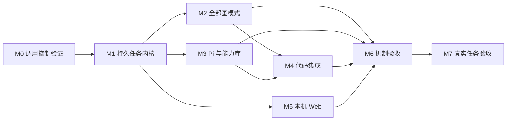

# Graph 首版实施计划

日期：2026-09-12。产品规则已经使用者确认。M0–M4（G01–G13）已形成可运行验证，见 [M0 报告](planning/m0-results.md)、[M1 报告](planning/m1-results.md)、[M2 报告](planning/m2-results.md)、[M3 报告](planning/m3-results.md)、[M4 报告](planning/m4-results.md)；M5–M7 尚未实现，尚未运行真实收费模型请求。

依据：[产品设计](graph-mvp.md)、[实现架构](architecture.md)、[术语表](../CONTEXT.md)。首版必须完成全部图模式、三类验证器和两组验收；中间里程碑用于验证进度，不作为缩减后的首版交付。

## 先做什么

下一项为 **M5 的 G14–G15**：本机 Web 展示真实后台状态、对话、任务图、问题与完整记录。以下工作包保留原出口定义，M0–M4 的完成证据与准确兼容范围记录在报告中。

M0 使用真实 Pi SDK 对接可控本地模型响应，并完成 G03 的本机执行限制验证。它没有完整界面，未操作 MediaBookmarks 的真实数据。

## 交付顺序

| 里程碑 | 可检查的结果 | 前置 |
| --- | --- | --- |
| M0 | Pi 调用控制、恢复基础与受限执行可行；准确依赖版本有验证记录 | 无 |
| M1 | 持久任务入口、单后台所有者、幂等命令与调用日志，可在无真实 LLM 下运行和恢复 | M0 |
| M2 | 全部图模式、子图、并发和验证器通过可控机制测试 | M1 |
| M3 | Pi 实例、主管规划、模型选择、人才库和自主能力安装贯通 | M1；沿用 M0 结论 |
| M4 | 临时项目完整实现 → 检查 → 独立审查 → 返工 → 自动合并 | M2、M3 |
| M5 | 本机 Web 展示真实后台状态、对话、任务图、问题与完整记录 | M1 后可并行，出口依赖 M2–M4 |
| M6 | 系统故障注入、后台重启与全部机制验收报告 | M2–M5 |
| M7 | Graph 完成 MediaBookmarks B站 Web 任务并交付合并证据 | M6；该任务的具体验收说明已确认 |

## M0 兼容性与调用控制验证

### G01 — 固定运行时与最小 Pi 会话

- 输入：Node 24 LTS、Pi SDK 公开接口及研究快照；现有宿主为 Node 26，不能据此默认 Node 24 已验证。
- 产物：局部运行时配置、package/lock、TypeScript 与测试脚本；持久会话创建/打开、两个独立实例、模型切换的最小案例。
- 出口：停掉进程后按精确 session 标识恢复；不同实例上下文不混用；模型不成为 Agent 定义身份。记录 npm 发布版本和所依赖 API，避免只固定 Git main 文档。

### G02 — 逐调用准入、暂停与 usage 路径

- 依赖：G01。
- 覆盖普通模型调用、同批多个工具、自动压缩、摘要、上下文溢出重试、provider 内部重试、工具内部 LLM 与扩展请求。
- 出口：在任一实际发送前关闭门后都不产生新请求；已发送调用可结束；未知 usage 暂停实例；缓存/推理分项不重复累计；重发同一个结果不重复记账。
- 若 high-level SDK hook 不能覆盖，使用受控 lower-level adapter 或最小上游补丁，写清维护范围并复验。不能用“回合暂停”替代“调用暂停”。

### G03 — 工具、安装与扩展的执行限制

- 可与 G02 并行；以当前 macOS 为首个验证宿主，不承诺未测平台支持。
- 产物：受限 worker/安装器/MCP 执行方式、凭据代理、允许范围和拒绝证据。
- 出口：直接写授权目录外、修改正式库、继承凭据直连供应商、子进程/符号链接绕过被阻止；获授范围内的代码读写、依赖安装和资料检索成功。
- 已配置域名允许检索不能自动授权发布。验证结构化读取/写入 broker 与 OS 限制组合；能力不兼容时报告具体原因，不能自动切换无限权限。

**M0 总出口**：三项均有可运行证据；结果已写入 `docs/planning/m0-results.md`。通过范围为固定版本 Pi、受控 OpenAI chat-completions SSE 和当前 macOS 宿主。其他供应商 transport、完整 MCP client 与生产后台的接入仍须沿用相同规则复验，不降低产品标准。

## M1 持久任务内核

### G04 — 状态存储、命令与快照

- 依赖：G01、G02、G03。
- 建立 Task Runtime interface、需求版本与任务队列、SQLite schema/migration、幂等回执、事件游标和一致快照。
- 用户主体与主管提案通道分开；需求确认后才派发实现工作，新增功能另建任务。
- 出口：相同请求不重复建任务；旧需求版本无法确认；关闭重开磁盘数据库后任务/队列不丢，SSE 的底层更新可重复订阅并去重。

### G05 — 操作日志、名额、额度与恢复骨架

- 依赖：G04；先使用 scripted Agent adapter。
- 产物：调用意图/派发/结果/不明/核对流程、预留与结算、后台所有权、旧 worker 代次检查、问题与人工答复。
- 出口：暂停与派发竞争无越界调用；崩溃后不盲重做；缺失用量暂停；重试/恢复不重置额度；第二后台不能重复派发；主管等待可释放名额。
- 首条垂直切片：确认任务 → 一个 Agent → 程序检查 → 持久交付证据，包含一次进程重启。此时不宣称已完成真实自动合并。

M1 已实现固定 DAG、任务级命令、逐操作日志/结算、单所有者和恢复核对；生产 Pi、常驻 HTTP/Web 宿主及完整动态图仍待后续工作包。M1 的程序验收不是自动 Git 合并，准确范围见 [M1 报告](planning/m1-results.md)。

## M2 全部图模式与验证器

### G06 — 版本化图、激活与子图

- 依赖：G05。
- 实现节点/实例唯一性、程序节点、容器、图提案校验、输入/产物版本、分支激活和汇合。
- 出口：顺序、条件路由、扇出扇入、嵌套均可运行；同节点回环不重建实例；旧循环成功不能错误放行新循环；等待后的激活仍在全局 10 名额内。

### G07 — 主管等待与返工循环

- 依赖：G06。
- 产物：主管-工人模式、问答等待/恢复、失败分支返工、有效结果复用和三轮无进展计数。
- 出口：一个慢分支不阻塞独立分支的后继；主管恢复不造成第 11 个活跃 Agent；无实质进展有具体阻塞证据；耗尽工作不能换名或新建实例逃逸。

### G08 — 三种验证器与预设模板

- 依赖：G06、G07。
- 产物：全部模式可复用模板、结构化反例/维度/候选评分、按任务确认的参数与证据格式。
- 出口：有效阻塞反例不能被多数票压过；必需维度不能跳过；全部候选不合格返工；胜者吸收其他方案后重新验证；模板可以嵌套而不另建调度器。

M2 已用 scripted adapter 在 Task Runtime 接口上验证 G06–G08；生产 Pi 见 [M3 报告](planning/m3-results.md)，自动 Git 集成见 [M4 报告](planning/m4-results.md)，Web 仍待 M5。准确范围见 [M2 报告](planning/m2-results.md)。

## M3 Pi、主管与可复用人才库

### G09 — 生产 Pi adapter 与模型目录

- 依赖：G05、M0 验证结论；可与 G06 并行。
- 产物：精确实例会话恢复、任务说明包、模型等级/偏好/候选、归一化 usage、价格版本与估算费用。
- 出口：每次请求归属唯一实例和 invocation；模型切换保留身份/工作副本/额度；审查排除本轮实现模型；无合格候选进入问题列表；未知价格不记零。
- 可控服务验证通过后，以使用者配置的实际模型做少量契约验证；供应商 key 通过运行配置注入，不写入文档或前端。

### G10 — Agent 库与能力安装

- 依赖：G03、G04；与 G09 可并行，最终与它集成。
- 产物：库定义版本、能力来源与版本、推荐等级、配置快照、自主搜索安装入口和受限安装记录。
- 出口：同定义不同模型可生成实例；定义升级不改变运行实例；能力安装中断可核查/补做；主管可复用新增能力，但不能通过安装扩张权限。

### G11 — 主管规划与结果交接

- 依赖：G07、G09、G10。
- 产物：需求讨论、验收说明、图提案、Agent 创建、局部返工、证据汇总和人工问题处理。
- 出口：通过一个临时项目任务，自主拆解并并行执行；不需要用户复制上下文；主管提案仍接受程序校验；新增功能进入队列、原任务继续原范围。

M3 已用可控本地 OpenAI chat-completions 服务与 scripted 主管验证 G09–G11；未读取 `.env`、未调用收费模型。准确范围见 [M3 报告](planning/m3-results.md)。

## M4 代码集成与自动合并

### G12 — 实例工作副本与任务集成分支

- 依赖：G05、G06；实现可早于整个 M3 完成。
- 产物：副本与分支生命周期、受控 Git 写入、合并冲突证据、任务/节点提交关联。
- 出口：多个实例并行修改互不覆盖；共同 Git 元数据操作受控；真实临时仓库中可集成、保留失败现场、恢复半完成 Git 操作。

### G13 — 验收证据与最终合入

- 依赖：G08、G09、G11、G12。
- 产物：验收项到检查方式/证据的映射、独立审查、集成提交检查与目标分支变化处理。
- 出口：代码、测试或目标分支变化使不适用证据失效；满足验收与审查才合入；人工检查项等待用户；目标脏工作区不被覆盖；合并成功后落账前崩溃能核对完成。

M4 已用真实临时 Git 仓库与 Task Runtime 验证 G12–G13；未读取 `.env`、未调用收费模型。准确范围见 [M4 报告](planning/m4-results.md)。

## M5 本机 Web 与运行观测

### G14 — 用户操作与后台连接

- 依赖：G04、G05；可与 M2/M3 并行。
- 页面：项目与模型设置、主管对话、需求确认、任务队列、待处理问题。
- 所有操作走 Task Runtime；本机身份、Origin 检查和接口权限防止主管通道伪造用户答复。
- 出口：暂停显示 pausing/paused；回复问题不清除其他阻塞；关闭浏览器后后台继续，重开从游标看到同一任务。

### G15 — 图、人才库与节点详情

- 依赖：G06、G09、G10、G14。
- 页面：自动布局任务图、子图展开/折叠、节点调用和产物、审查反馈、token/费用/耗时、Agent 库和能力库。
- 出口：全部模板及回边都能呈现；不提供手工改图；查看大日志不阻塞调度；图变更与模型版本可追踪；未知费用显示未知。

## M6 执行机制验收

### G16 — 故障注入与完整机制报告

- 依赖：G08–G15 全部完成。
- 使用真实磁盘 SQLite、真实临时 Git、实际受限进程和 scripted 模型/MCP 响应。
- 出口：下方验收矩阵全部通过；后台停止/重启、旧 worker、重复事件、未知用量和副作用、目标分支竞态均有可重复证据。
- 对通过的范围保存依赖锁、平台、测试命令和报告；改实现后只重跑受影响检查及必要回归，不以截图替代机制证明。

## M7 MediaBookmarks 真实任务验收

### G17 — 在 Graph 内形成该任务的验收说明

- 依赖：G16；输入为已有项目 `/Users/macmini/workspace/12-MediaBookmarks`。
- 已固定范围：本机 Web，复用现有 CLI，B站确认登录 → 采集 → 进度/失败原因 → 收藏与已有笔记 → Markdown 导出。
- 在 Graph 的需求讨论中明确具体界面、测试数据和人工登录/检查步骤，固定验收说明与目标分支。保留现有其他平台 CLI 和 JavaScript/Python 代码，不把 Graph 的技术约束强加给目标项目。
- 不把浏览器 profile、真实收藏或登录态当成可无条件并发共享资源；由该任务确认资源访问方式。

### G18 — 由 Graph 自主交付与合并

- 依赖：G17。
- Graph 自行拆解、分配独立副本、自动交接、实现、检查、独立审查、返工并合并。
- 出口：可运行的已确认 B站流程、测试结果、独立审查结论、合并提交、任务图与完整用量/费用记录；用户未人工拆任务或转发上下文。需要用户确认的需求、登录和明确人工介入按规则记录。
- 用户决定发布；真实任务成功与 M6 机制通过共同构成 Graph 首版完成，缺一不可。

## 验收覆盖矩阵

| 编号 | 行为 | 实施来源 | 验证方式 |
| --- | --- | --- | --- |
| A01 | 需求确认、单任务队列、新增功能另建任务 | G04、G11、G14 | 任务 interface 集成测试 + Web 流程 |
| A02 | Agent 库版本、模型不参与身份、实例/节点一一对应 | G06、G09、G10 | 定义升级/模型切换/原节点返工场景 |
| A03 | 顺序、条件、并行汇合、主管-工人、评估优化 | G06、G07 | 每模式正常/失败/回环案例 |
| A04 | 对抗、多视角、评委及胜者改进后复验 | G08 | 有效反例、必需维度失败、全部候选失败等案例 |
| A05 | 嵌套共用 10 名额、等待释放、恢复重取 | G05–G07 | 多层容器与主管唤醒竞态 |
| A06 | 20M 额度、缓存去重、重试/恢复不清零、缺失用量暂停 | G02、G05、G09 | 可控实际请求和归一化 contract test |
| A07 | 模型替换与独立审查排除 | G09、G13 | 多次换模型、无候选、重新审查 |
| A08 | 暂停逐调用生效、关闭界面继续、重启核查 | G02、G05、G14、G16 | 在模型/工具发送边缘暂停、杀后台再启动 |
| A09 | 局部阻塞、独立分支继续、三轮无进展介入 | G07、G11 | 失败/返工脚本、用户问题范围断言 |
| A10 | 状态由程序掌握、授权不越界、自主安装可用 | G03、G05、G10 | 真实 worker 越界测试和授权内成功路径 |
| A11 | 代码集成、目标变化重检、证据对应准确提交 | G12、G13 | 临时真实仓库冲突/竞争/崩溃测试 |
| A12 | 任务图、人才库、产物、反馈、token/费用/耗时 | G14、G15 | Web 端到端 + 断线游标恢复 |
| A13 | MediaBookmarks B站完整流程由 Graph 交付 | G17、G18 | 真实运行报告、验收证据与合并提交 |

## 实施协作与任务平台

G01–G18 是可发布到 GitHub Issues 的工作包草稿，每项已有范围、前置与完成条件。当前没有 GitHub 目标仓库，因此保存在本文，未创建 Issue，也未改成另一套任务平台。

可并行的工作以已稳定 interface 为前置：M0 中调用控制与执行限制、M1 后图规则/Pi/界面、M3 中模型 adapter/能力库。每个工作包保持独立修改范围；存储 schema 和核心 interface 的变更由同一集成负责人协调。任何中间版本都不将“尚未做的图模式”改成首版范围外。

M0–M4 验证通过只表示底层接入、持久任务恢复、全部图模式、Pi/人才库规划及临时仓库自动合入有运行证据；M5–M7 及完整产品验收仍待完成。
